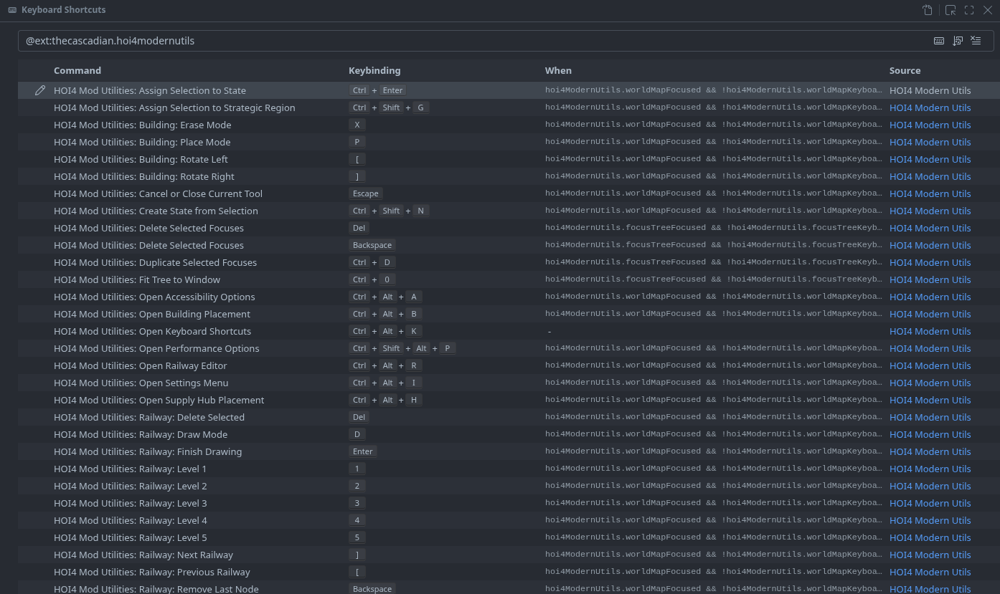

# HOI4 Modern Utils


A Visual Studio Code extension for Hearts of Iron IV mod development. It adds rich previews, a data-aware world-map editor, validation tools, and transactional persistence workflows for common map edits.

**[Install](#install)** · **[Quick start](#quick-start)** · **[World map](#world-map-tools)** · **[Shortcuts](#keybindings-and-shortcuts)** · **[Settings](#extension-settings)** · **[Docs](docs/wiki/Home.md)** · **[Troubleshooting](#known-limitations)**

> **Measured performance value:** the opt-in WebGL2 base-map renderer reduced median render time by **82.6%** compared with the original Canvas2D renderer, from 42.5 ms to 7.4 ms, or about **5.7x faster**, across 312 authentic-map webview cases at 0.25x zoom. WebGL2 is not pixel-identical to Canvas2D, has a first-frame geometry cost, and remains disabled by default.

---

## Install

<details open>
<summary><strong>Install from a VSIX</strong></summary>

Download a `.vsix` from the project's GitHub Releases, or build one from this repository:

```powershell
npx.cmd vsce package --allow-star-activation
```

Install the generated package from a terminal:

```powershell
code.cmd --install-extension .\hoi4modernutils-<version>.vsix --force
```

Alternatively, use **Extensions: Install from VSIX...** in VS Code. The version is taken from `package.json`, so the generated filename changes with each release.

</details>

## Quick start

1. Install and enable the extension.
2. Set `hoi4ModernUtils.installPath` to the Hearts of Iron IV installation folder, or run **HOI4 Modern Utils: Select HOI4 install path** from the Command Palette.
3. Open the root folder of your mod in VS Code.
4. Optionally run **HOI4 Modern Utils: Select mod file** to choose the active `.mod` descriptor. If exactly one workspace descriptor is available, it is selected automatically.
5. Open the Command Palette with `Ctrl+Shift+P` and choose **Preview World Map** or **Preview HOI4 file**. You can also open `.dds` and `.tga` files directly.

The Preview HOI4 file toolbar button is available for supported HOI4 text files, including `.gfx`, `map/default.map`, technology trees, and national focus trees.

> **Before destructive edits:** commit or back up your mod. Writes are correlated with the extension host and rolled back on reported failure, but no editor is a substitute for source control.

---

## Highlights

- **World map editor** with province, state, strategic-region, supply-area, country, and warning views.
- **Every keyboard action is rebindable** in VS Code's Keyboard Shortcuts editor, opened with `Ctrl+Alt+K`, the Command Palette, or the extension's gear menu.
- **Railways and supply hubs** are edited directly on the map and saved automatically to `map/railways.txt` and `map/supply_nodes.txt`.
- **Transactional map edits:** painting, province creation, merging, transfers, and country tools save dependent files together.
- **Rich previews** for focus trees, event trees, technology trees, MIOs, GUI, `.gfx`, `.dds`, and `.tga`.
- **Validation and diagnostics** that report map warnings and can write a timestamped scan report.

---

## World map tools

Most editing tools live in the **Shift+right-click** map menu. The available actions follow the active Province, State, Strategic Region, or Supply Area view, so a tool only appears where its selection has a clear meaning.

<details>
<summary><strong>Map selection and navigation</strong>: clicking, selecting, searching, zooming</summary>

- Click to select a province, `Ctrl`+click to add or remove it from a selection, and `Shift`+left-drag to select multiple provinces in Province view.
- Search province or state IDs from the map search box, then press `Enter` to run the search.
- Right-drag to pan the map. Wheel zoom is centered on the pointer and ranges from 0.25x to 64x.
- Zoom changes continuously between former whole-number levels. Hold `Shift` while scrolling for smaller precision adjustments.
- Double-click a province to add or remove a placeholder victory point. Double-click a state, strategic region, or supply area to open its source file.
- Use `Shift`+right-click for the contextual map menu, including export, warnings, map actions, and country tools.
- Country mode includes country borders, selection, and owned/controlled/core summaries. Compact Large Tooltips can reduce oversized map tooltips.
- The **Select All** menu provides separate province, land, ocean, river, lake, coastal, other-type, and terrain selections. River selection retains exact `rivers.bmp` components for clipped river-to-ocean conversion.

</details>

<details>
<summary><strong>Railway and supply hub editor</strong>: draw, extend, reroute, place hubs</summary>

Open the editor from the railway toolbar button or the configured **Open the railway editor** shortcut (default `Ctrl+Alt+R`). Every railway is drawn on the map, colored by level.

- **Select** picks a railway by clicking its line; click again to cycle overlapping railways. Select a node to split there, `Shift`+click a node to remove it, and `Alt`+click a province to detour through it.
- **Draw** starts a new railway or extends the selected one from its end or start. Auto-connect fills gaps along the shortest land route.
- Change the level, reverse, split at a selected node, or delete the selected railway. Clicking the tip again steps back one province.
- **Supply hub** mode places hubs instantly on land provinces. Open it from the panel, the map-pin toolbar button, or the configured shortcut (default `Ctrl+Alt+H`). Clicking a hub removes it. Hubs are drawn as red squares while the editor is open.
- Undo and redo use the configured map-edit shortcuts (default `Ctrl+Z` and `Ctrl+Y`).

Railway edits save to `map/railways.txt`; supply hub edits save to `map/supply_nodes.txt`. Leading comments in both files are preserved.

</details>

<details>
<summary><strong>Province painting and repair</strong>: brush, bucket, lasso, merge, references</summary>

- Paint province pixels directly on the map with exact square brush sizes, continuous gap-free strokes, a staged-pixel eraser, and draft undo/redo before saving.
- Create provinces from a selected area, or transfer pixels into an existing province with the Brush, Fill Bucket, Lasso, or Transfer Wand. New province IDs use a map-size-dependent cap equal to one eighth of the total `provinces.bmp` pixels.
- The Lasso stages exact same-type pixels inside a drawn polygon. Optional snapping cleans up nearly straight lines, and inverted mode selects eligible pixels outside the polygon.
- The Fill Bucket transfers one connected region and prevents invalid land, lake, and sea/ocean type transfers.
- Manual province merge ignores synthetic loader recovery records, including province `0` and color `0`.
- Merge provinces and repair affected state victory points, strategic-region membership, `adjacencies.csv`, `railways.txt`, and `supply_nodes.txt`.
- Use the standalone province-reference resolver to remove or repair invalid supported-map references.
- Province bitmap, `definition.csv`, and required state or strategic-region membership changes are saved as one transaction. Province BMP undo/redo restores every related file captured by that transaction.

</details>

<details>
<summary><strong>State, strategic-region, and country tools</strong>: create, assign, transfer, merge, annex</summary>

- Create states from the current selection, assign selected provinces to an existing state, and create or assign strategic regions. A province-scoped action can move exactly the selected province IDs into a new strategic region.
- Transfer provinces between states or copy state owner/controller assignments with the Transfer Wand.
- Create a three-character country TAG from selected states, including country definition, history, and English localisation files.
- Select multiple countries for bulk annexation, create puppet relationships, release puppets, transfer states, and optionally auto-core transferred states.
- Merge selected states with an explicit surviving state. The merge combines provinces, manpower, resources, cores, and victory points.
- Consolidate a loaded continent or run the sequential all-continent workflow. Guarded operations merge provinces, states, and strategic regions, repair references, and preserve cross-continent content.
- Selected Area Tools can clear railways, buildings, supply hubs, water crossings, and resources; set population to one; lower development; or convert eligible selections to ocean.

</details>

<details>
<summary><strong>Full tool reference</strong>: what each map action does and when to use it</summary>

| Tool | What it does | Example use case |
| --- | --- | --- |
| **Lasso** (`L`) | Draw a shape and stage every eligible land or water pixel inside it for the selected target province. Inverted mode stages pixels outside the shape instead. Nothing is written until **Apply** is pressed. | Redraw a crooked border by circling the exact pixels that should belong to the neighboring province. |
| **Fill Bucket** (`F`) | Moves one connected patch of pixels into the selected province without creating a new province ID. It will not mix incompatible land, lake, and sea types. | Transfer an island or isolated enclave to an existing province with one click. |
| **Transfer Wand** (`W`) | In Province view, moves clicked provinces into a chosen state. In State view, copies the chosen state's owner and controller to clicked states. | Clean up several misplaced provinces quickly, or give a row of states to the same country. |
| **State from Selected Provinces** | Creates a new state containing exactly the selected provinces. Empty source states are safely removed and supply-area references redirected. Victory points follow their provinces. | Split a large state into a new coastal state, including the coastal victory points. |
| **New Strategic Region from Selected Provinces** | Creates a strategic region from the exact selected province IDs rather than expanding to whole states. Empty source regions are removed. | Put only the sea provinces around an island chain into a dedicated naval region. |
| **Remove All Provinces from Selected States** | Empties selected states and removes their direct victory points, but keeps their files and unrelated scripted content. | Temporarily preserve scripted state history while rebuilding membership. |
| **Consolidate Selected Ocean Provinces to One Tile** | Combines selected sea provinces into one valid ocean province, clears state membership, and removes strategic regions left empty. | Turn many tiny offshore sea provinces into one simpler ocean tile. |
| **Convert Selected Water Provinces to Land** | Changes selected sea or lake provinces to land and asks for terrain, state, strategic region, and coastal metadata. | Reclaim a lake or add a landmass in one operation. |
| **Convert River Pixels to Ocean (Clipped)** | Uses the exact selected `rivers.bmp` component and converts only those river pixels. | Make a wide navigable river mouth without converting surrounding land. |
| **Verify Ocean-Tile Readiness** | Read-only checklist for definition, pixels, membership, strategic region, railways, and supply hubs. | Check a newly consolidated ocean tile before starting the game. |
| **Selected Area Tools** | Applies cleanup only to the current selection: railways, buildings, supply hubs, crossings, resources, population, development, or ocean conversion. | Remove infrastructure only from a region being rebuilt. |
| **REMOVE ALL PROVINCE BUILDINGS (ENTIRE MAP)** | After confirmation, removes every loaded state building block and province building record. | Prepare a minimal test map or regenerate buildings from scratch. |
| **REINDEX ALL PROVINCES AND STATES** | Renumbers loaded province and state IDs sequentially and rewrites supported references. | Normalize IDs after a large consolidation. External scripted numeric references still need review. |
| **Scan for World Map Errors and Write Log** | Runs the complete map loader without editing files and writes a timestamped report. | Attach one complete diagnostic report to a bug report. |

</details>

---

## Previews

<details>
<summary><strong>World map and file previews</strong>: focus, event, technology, MIO, GUI, images</summary>

- World map preview with province, state, strategic-region, supply-area, country, and warnings views.
- National focus tree, event tree, technology tree, military industrial organization, GUI, `.gfx`, `.dds`, and `.tga` previews.
- Localisation-aware preview text and configurable localisation language.
- Map display options for boundaries, labels, warnings, and color sets, including owner/controller and state-category data.
- Large DDS and TGA files open through a cached low-memory preview first, with an explicit full-resolution decode action.

</details>

<details>
<summary><strong>Rendering, accessibility, and diagnostics</strong>: performance menu, overlays, warnings</summary>

- The world-map Performance menu contains an opt-in WebGL2 base-map renderer and experimental Canvas2D controls. Warning indexing is fidelity-preserving; WebGL2, edge decimation, river pixel collapse, label-grid deduplication, and coarse province rendering can change pixel output and remain off by default.
- Experimental selections are saved with the map view. Options that may change fidelity require confirmation before they are enabled.
- The renderer clips off-viewport river work and uses indexed edge-neighbor lookups for responsive navigation.
- A movable Performance overlay reports live FPS, frame and base-map timing, redraw state, viewport position, zoom, canvas size, and active renderer.
- The **Settings → Accessibility** dialog can change font size and typeface, interface scale, panel opacity, glass blur, reduced motion, high contrast, and larger interaction targets. These preferences are saved with the World Map view.
- The extension reports map validation warnings for loaded province, state, strategic-region, supply-area, railway, river, terrain, and reference data.
- Run **HOI4 Modern Utils: Scan for World Map Errors and Write Log** to perform the full validation load and create a timestamped report in the workspace root. This command is read-only.

</details>

---

## Keybindings and shortcuts

Every keyboard action in the World Map and Focus Tree is a normal VS Code command. Run **HOI4 Mod Utilities: Open Keyboard Shortcuts** from the Command Palette, press `Ctrl+Alt+K`, or open the extension's gear menu in the Extensions view and choose **Keyboard Shortcuts**. The editor opens filtered to this extension. Bindings are stored in VS Code's own `keybindings.json`, so the Keyboard Shortcuts editor is the single place to view, change, or reset them. VS Code reports conflicts, and each binding only fires while the matching view or tool has focus. The Settings panel hosts configuration values only, so keybindings are changed in the Keyboard Shortcuts editor.



<details>
<summary><strong>Map shortcuts</strong>: selection, editing, tools, menus</summary>

| Default | Action |
| --- | --- |
| `P` | Toggle Brush |
| `E` | Toggle the staged-pixel eraser while painting |
| `F` | Toggle Fill Bucket |
| `L` | Toggle Lasso |
| `W` | Toggle Transfer Wand |
| `Ctrl+Alt+P` | Start new-province painting |
| `Esc` | Cancel or close the current tool |
| `Ctrl+Z` | Undo the last map edit |
| `Ctrl+Y` | Redo the last map edit |
| `T` | Undo the last selection change, or the current staged paint draft while painting |
| `R` | Redo the last selection change, or the current staged paint draft while painting |
| `Ctrl+Shift+N` | Create a state from the current selection |
| `Ctrl+Enter` | Assign the current selection to a state |
| `Ctrl+Shift+G` | Assign selected states to a strategic region |
| `Ctrl+Alt+R` | Open the railway editor |
| `Ctrl+Alt+H` | Open supply hub placement |
| `Ctrl+Alt+B` | Open building placement |
| `Ctrl+Alt+I` | Open the Settings menu |
| `Ctrl+Alt+A` | Open accessibility and interface preferences |
| `Ctrl+Alt+Shift+P` | Open experimental performance options |

</details>

<details>
<summary><strong>Railway editor shortcuts</strong>: only while the editor is open</summary>

| Default | Action |
| --- | --- |
| `S` | Select mode |
| `D` | Draw mode |
| `H` | Supply hub mode |
| `R` | Reverse the selected railway |
| `X` | Split the selected railway at the selected node |
| `Delete` | Delete the selected railway |
| `Backspace` | Remove the last node |
| `[` / `]` | Previous / next railway |
| `Tab` | Switch the extension end between start and end |
| `Enter` | Finish drawing |
| `1`-`5` | Set the railway level |

</details>

<details>
<summary><strong>Building placement shortcuts</strong>: only while placement is open</summary>

| Default | Action |
| --- | --- |
| `P` | Place mode |
| `X` | Erase mode |
| `[` / `]` | Rotate left / right |

</details>

<details>
<summary><strong>Focus tree shortcuts</strong>: only while a focus tree preview is focused</summary>

| Default | Action |
| --- | --- |
| `Ctrl+0` | Fit the whole tree to the window |
| `Delete` / `Backspace` | Delete the selected focuses |
| `Ctrl+D` | Duplicate the selected focuses |
| `Arrow keys` | Move the selected focuses by one grid step |
| `Shift+Arrow keys` | Move the selected focuses by five grid steps |

</details>

When both an edit undo/redo and a selection undo/redo are relevant, use the dedicated configured shortcut for the type of change you want to reverse.

---

## Extension settings

<details>
<summary><strong>All extension settings</strong>: paths, indexing, map behavior, keybindings</summary>

| Setting | Type | Description |
| --- | --- | --- |
| `hoi4ModernUtils.installPath` | `string` | Hearts of Iron IV installation path. Most previews require it. |
| `hoi4ModernUtils.loadDlcContents` | `boolean` | Load DLC images while previewing. This increases memory use. |
| `hoi4ModernUtils.modFile` | `string` | Active `.mod` descriptor used for `replace_path` and mod resolution. |
| `hoi4ModernUtils.enableSupplyArea` | `boolean` | Enable supply-area support for compatible HOI4 versions. |
| `hoi4ModernUtils.previewLocalisation` | `enum` | Language used for content in preview windows. |
| `hoi4ModernUtils.indexing` | `string[]` | File categories indexed automatically for previews and references. |
| `hoi4ModernUtils.stateBoundaryColor` | `string` | CSS color for state boundaries in Province view. |
| `hoi4ModernUtils.stateBoundaryWidth` | `number` | State-boundary line-width multiplier in Province view. |
| `hoi4ModernUtils.featureFlags` | `string[]` | Enables or disables feature flags. Reload VS Code after changing them. |
| `hoi4ModernUtils.worldMapConfirmNewProvinceCreation` | `boolean` | Require confirmation before creating a new province. |
| `hoi4ModernUtils.worldMapAutoCoreTransfers` | `boolean` | Automatically add cores when states are transferred, annexed, or used to create a country. |

</details>

<details>
<summary><strong>Feature flags</strong>: optional behavior switches</summary>

The `hoi4ModernUtils.featureFlags` array accepts:

- `useConditionInFocus`: enable conditional behavior in focus previews.
- `eventTreePreview`: enable event-tree preview behavior.
- `rightButtonDrag`: enable right-button map dragging.
- Prefix any listed value with `!` to explicitly disable it.

Reload VS Code after changing feature flags.

</details>

---

## Known limitations

<details>
<summary><strong>What this extension does not guarantee</strong></summary>

- Focus-tree and MIO preview layout is not fully configurable like the technology-tree preview.
- World-map edge lines can differ slightly from province-color edges in some cases.
- WebGL2 and the lossy experimental Performance options can change pixel output or visual detail. Leave them disabled when exact Canvas2D appearance matters.
- The built-in reindexer repairs supported loaded map files, but it cannot discover every province or state ID embedded in arbitrary external scripts. Review custom scripted numeric references after reindexing.
- Ocean readiness validation does not inspect every external script or every possible generated building source.
- Build and automated webview results do not prove that a generated mod launches cleanly in every HOI4 version or playset. Validate destructive edits in the target game configuration.
- Destructive operations show confirmation UI. Review the affected selection and commit or back up your mod before running them.

</details>

## Demos

<details>
<summary><strong>World map preview</strong></summary>


</details>

<details>
<summary><strong>Focus tree preview</strong></summary>


</details>

<details>
<summary><strong>Event tree preview</strong></summary>


</details>

<details>
<summary><strong>Technology tree preview</strong></summary>


</details>

<details>
<summary><strong>GUI preview</strong></summary>


</details>

---

## Contribute

Report issues or propose improvements in the [project issue tracker](https://github.com/TheCascadian/HOI4ModernUtils/issues). Translation contributions are welcome; localisation files are in `i18n`.

See the [wiki](docs/wiki/Home.md) for deeper documentation and [CHANGELOG.md](CHANGELOG.md) for release-by-release detail.
